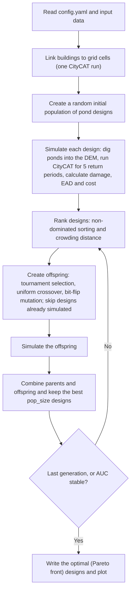

# CONFIGURE v1.2: detention pond optimisation for urban flood risk

[](https://github.com/asidurrehman/Configure12/actions/workflows/tests.yml)
[](LICENSE)
[](https://doi.org/10.1016/j.ijdrr.2025.105901)
[](requirements.txt)

This repository contains the Python code for the Cost-benefit Optimisation Framework for Implementing blue-Green infrastructURE (**CONFIGURE**) version 1.2. This version is designed specifically to optimise the **location and size of detention ponds** for **multiple rainfall return periods** by calculating Expected Annual Damage (EAD).

The associated article, **Integrated evolutionary optimisation framework for explicit configuration of detention ponds in urban flood risk management**, is published in the *International Journal of Disaster Risk Reduction*: <https://doi.org/10.1016/j.ijdrr.2025.105901>

Earlier versions: [CONFIGURE v1.0](https://github.com/asidurrehman/Configure10) and [CONFIGURE v1.1](https://github.com/asidurrehman/Configure11).

## Contents

- [Overview](#overview)
- [How it works](#how-it-works)
- [Repository structure](#repository-structure)
- [Understanding the code](#understanding-the-code)
- [Requirements](#requirements)
- [Installation](#installation)
- [Input data and folder layout](#input-data-and-folder-layout)
- [Configuration](#configuration)
- [Usage](#usage)
- [Outputs](#outputs)
- [Running the tests](#running-the-tests)
- [Citation](#citation)
- [Licence](#licence)

## Overview

CONFIGURE couples the multi-objective genetic algorithm **NSGA-II** with the **CityCAT** hydrodynamic flood model.

- **Decision variables:** which candidate ponds are built, and how large each one is (in steps of 100 m²).
- **Objectives (both minimised):**
  - pond life cycle cost, in million £;
  - Expected Annual Damage (EAD) to buildings, in million £. EAD is calculated from the direct damage for five rainstorm return periods (T = 10, 20, 30, 50 and 100 years).
- **Evaluation:** each candidate design is dug into the digital elevation model (DEM), and CityCAT is run once for each return period. Buildings are then classed by flood exposure and their damage is calculated from depth-damage curves.
- **Stopping rule:** the run stops after `max_generations`, or earlier once the area under the cost-EAD curve improves by less than 0.001 for 5 generations in a row.

## How it works



## Repository structure

```
Configure12/
├── configure12_main.py        # Main script: runs the optimisation
├── configure12_functions.py   # NSGA-II operators, CityCAT coupling, damage and plotting
├── config.yaml                # Paths and run settings
├── environment.yaml           # Conda environment
├── requirements.txt           # pip requirements
├── pyproject.toml             # Project metadata and tool settings
├── tests/                     # Automated tests (synthetic case, stand-in for CityCAT)
├── .github/workflows/         # Continuous integration (GitHub Actions)
├── CITATION.cff               # Citation metadata ("Cite this repository" on GitHub)
├── CHANGELOG.md
└── LICENSE
```

## Understanding the code

Both Python files contain detailed comments written for people who want to understand, run or adapt the framework. A suggested reading order:

1. **`configure12_main.py`, top of the file.** The **HOW THIS SCRIPT WORKS** block lists the steps of a run in order (STEP 1 to STEP 9, with sub-steps 8a–8g for the generation loop). Each step has a matching `STEP n` header further down, so you can search for it.
2. **NAMING CONVENTIONS**, directly below. It explains how one pond design is stored in three linked forms (location chromosome, size chromosome, size values) and what the variable prefixes mean (`i_` initial, `p_` parents, `o_` offspring, `comb_` combined, `f_` fittest, `gen_`, `simulated_`, `opt_`).
3. **The rest of `configure12_main.py`**, step by step. Inline comments give array shapes, units and the reason for each step, including how the Expected Annual Damage is calculated and how the stopping rule works.
4. **`configure12_functions.py`.** An overview at the top lists every function and its role. Comments inside the functions walk through the NSGA-II operators (non-dominated sorting, crowding distance, tournament selection, crossover and mutation), and through how ponds are dug into the DEM, how CityCAT is run and how exposure and damage are calculated.

Two kinds of tagged comments are worth searching for:

- `USER INPUT:` marks values you may want to change that are still set in the code, such as pond depth, size step, grid-cell area and the genetic operator probabilities. Most run settings are in [`config.yaml`](config.yaml) instead.
- `NOTE (known issue):` marks known limitations and possible bugs in the published code. They are left unchanged so that results stay identical to the article.

## Requirements

- **CityCAT**, which is **not included** in this repository and must be obtained separately. Your CityCAT model set-up (rainfall and configuration files) must be in the run folder (see below).
- **Windows**, because the code starts CityCAT as `citycat.exe` through the Windows command shell. The automated tests run on any operating system.
- **Python 3.10–3.12**, with the packages in [`requirements.txt`](requirements.txt). NumPy must be below version 2 and pandas below version 3. The code uses `np.trapz` and pandas behaviour that newer releases have removed, and these limits keep results identical to the published study.

## Installation

With conda (recommended on Windows, because it provides GDAL-based packages such as rasterio):

```bash
git clone https://github.com/asidurrehman/Configure12.git
cd Configure12
conda env create -f environment.yaml
conda activate configure
```

Or with pip:

```bash
git clone https://github.com/asidurrehman/Configure12.git
cd Configure12
python -m venv .venv
.venv\Scripts\activate          # on macOS/Linux: source .venv/bin/activate
pip install -r requirements.txt
```

## Input data and folder layout

All inputs are read from the **run folder** (`run_path` in `config.yaml`). The script changes its working directory to this folder, and writes all outputs there.

```
<run_path>/                                  e.g. C:/z/configure12
├── citycat.exe                              CityCAT (here or on the system PATH)
├── ... CityCAT rainfall and configuration files
├── domain_dem_original/
│   └── Domain_DEM.asc                       Original DEM (ESRI ASCII grid)
├── vector/
│   ├── buildings.shp                        Building footprints
│   ├── all_possible_ponds_grid.shp          Grid cells of every candidate pond
│   └── catchment_dem.shp                    Polygon of the DEM extent
└── dd_data/
    ├── residential_damage_calculation.csv
    └── non_residential_damage_calculation.csv
```

| File | What it must contain |
|------|----------------------|
| `domain_dem_original/Domain_DEM.asc` | DEM as an ESRI ASCII grid with the usual six header lines (`ncols`, `nrows`, `xllcorner`, `yllcorner`, `cellsize`, `NODATA_value`). `xllcorner`, `yllcorner` and `cellsize` must be whole numbers. |
| `vector/buildings.shp` | Building polygons with a unique ID field `UID` and a field `Type`. Damage is calculated for `Residential`, `Retail`, `Offices` and `Public Buildings`. |
| `vector/all_possible_ponds_grid.shp` | One 5 m × 5 m (25 m²) polygon for each DEM cell of each candidate pond, with fields `Id` (pond number 1, 2, 3, … with no gaps) and `elevation` (ground level, m). |
| `vector/catchment_dem.shp` | A polygon covering the DEM extent. It keeps the edited DEM aligned with the original. |
| `dd_data/residential_damage_calculation.csv` | Depth-damage curve for homes: a header row, then flood depth (m) in the first column and damage per building (£) in the second. |
| `dd_data/non_residential_damage_calculation.csv` | A header row, then flood depth (m) and damage per m² of building area (£) for retail, offices and public buildings, in that column order. |

Notes on the inputs:

- CityCAT must be able to run with **configuration 1** (used once, with the first rainfall number, to link buildings to grid cells) and with the configuration given by `config_num`. It must also be able to run with every rainfall number in `rainfall_num`.
- The code reads CityCAT's maximum-depth output `R<rainfall>C<config>_SurfaceMaps/R<rainfall>_C<config>_max_depth.csv`, which has x, y and depth columns.
- For every design, the script writes the edited DEM to `<run_path>/Domain_DEM.asc`, which is the DEM that CityCAT reads. Keep your original DEM in `domain_dem_original/`.
- Depths above 3 m are capped at 3 m when calculating damage, because the depth-damage curves (Multi-Coloured Manual) stop there.

## Configuration

Settings are in [`config.yaml`](config.yaml). The values provided are those used in the published study.

| Key | Meaning | Published value |
|-----|---------|-----------------|
| `run_path` | Run folder that holds CityCAT and the inputs; outputs are written here | `C:/z/configure12` |
| `rainfall_num` | CityCAT rainfall file numbers for T = 10, 20, 30, 50 and 100 years, **in this order** (the EAD calculation assumes exactly these five) | `[1060, 2060, 3060, 5060, 10060]` |
| `config_num` | CityCAT configuration file number for the optimisation runs | `3` |
| `pop_size` | Designs per generation | `100` |
| `max_generations` | Maximum number of generations | `50` |
| `pond_unit_vol_lcc` | Pond life cycle cost (25 years), £ per m³ | `153.2` |
| `plot_x_limit`, `plot_y_limit` | Axis limits `[min, max]` for the plots (cost and damage, million £) | `[-0.05, 3.1]`, `[5.84, 6.4]` |

Some settings remain in `configure12_main.py`. These include pond depth (1 m), the size step (100 m²), pond grid cell area (25 m²), crossover probability (0.6), mutation probabilities (0.02) and the stopping rule (0.001 over 5 generations). The flood exposure thresholds are in `configure12_functions.py`.

## Usage

1. **Prepare the run folder** with your CityCAT set-up and the inputs listed above.
2. **Edit `config.yaml`**. Set `run_path` to your run folder, and adjust the other settings for your case. In particular, set the plot axis limits to the range of your costs and damages.
3. **Run the optimisation:**
   - in **Spyder**, open `configure12_main.py` and press *Run* (F5). It uses `config.yaml` from the same folder;
   - or from a **command prompt** in the repository folder:
     ```bash
     python configure12_main.py
     python configure12_main.py --config path/to/my_case.yaml   # another settings file
     ```
4. **Follow progress** in the console. Each design needs one CityCAT run for each return period, so a generation of 100 designs requires 500 CityCAT runs.
5. **Collect the results** from the run folder (see [Outputs](#outputs)).

## Outputs

All outputs are written to the run folder.

| File | Contents |
|------|----------|
| `simulated_data.csv` | Every design simulated so far (updated after each generation) |
| `generation_data.csv` | The population kept at each generation |
| `optimised_data.csv` | The final non-dominated (Pareto-optimal) designs |
| `Generation_No_<g>.png` | Cost against EAD for generation `<g>` (0 = initial population) |
| `Generation_No_<g>_optimal.png` | The final Pareto front |
| `Domain_DEM.asc`, `R…_SurfaceMaps/` | DEM and CityCAT results of the most recent simulation (overwritten each time) |

The three CSV files share these columns:

| Column | Meaning |
|--------|---------|
| `SN` | Row number |
| `Generation` | Generation in which the design was simulated or kept |
| `Size_Steps_Pond_<i>` | Number of 100 m² size steps of pond *i* (0 = pond not built) |
| `Pond_Volume_<i>` | Volume of pond *i* (m³) |
| `Cost` | Life cycle cost of the design (million £) |
| `DD_1030` … `DD_10030` | Direct damage (£) for each rainfall in `rainfall_num`, in order |
| `EAD` | Expected Annual Damage (million £) |

EAD is the area under the damage-probability curve from an annual exceedance probability of 1/10 down to 0. It is calculated with the trapezoidal rule, and damage beyond the 100-year event is extrapolated linearly from the 50- and 100-year values.

## Running the tests

The tests use a small synthetic case and a stand-in for CityCAT. They therefore run on any operating system, without CityCAT or the study data:

```bash
pip install pytest
pytest
```

They cover the genetic algorithm operators, the DEM and pond handling, the exposure and damage calculation, and a complete short run of `configure12_main.py`. GitHub Actions runs them automatically on Windows and Linux for every push and pull request.

## Citation

Asid Ur Rehman developed this optimisation framework as part of his PhD study at Newcastle University. If you use this code, please acknowledge its source with the following citation:

*Ur Rehman, A., Glenis, V., Lewis, E., Kilsby, C., & Walsh, C. (2025). Integrated evolutionary optimisation framework for explicit configuration of detention ponds in urban flood risk management. International Journal of Disaster Risk Reduction, 131, 105901. https://doi.org/10.1016/j.ijdrr.2025.105901*

```bibtex
@article{UrRehman2025ponds,
  author  = {Ur Rehman, Asid and Glenis, Vassilis and Lewis, Elizabeth and Kilsby, Chris and Walsh, Claire},
  title   = {Integrated evolutionary optimisation framework for explicit configuration of detention ponds in urban flood risk management},
  journal = {International Journal of Disaster Risk Reduction},
  volume  = {131},
  pages   = {105901},
  year    = {2025},
  doi     = {10.1016/j.ijdrr.2025.105901}
}
```

GitHub's **"Cite this repository"** button (from [`CITATION.cff`](CITATION.cff)) gives the same reference in other formats.

The building exposure analysis is adapted from *Building level flood exposure analysis using a hydrodynamic model*, Environmental Modelling & Software (2022), <https://doi.org/10.1016/j.envsoft.2022.105490>.

## Licence

Asid Ur Rehman (C) 2025. Licenced under the terms of the [GNU General Public License v3.0](LICENSE).

## Contact

Questions and bug reports are welcome through [GitHub issues](https://github.com/asidurrehman/Configure12/issues).
